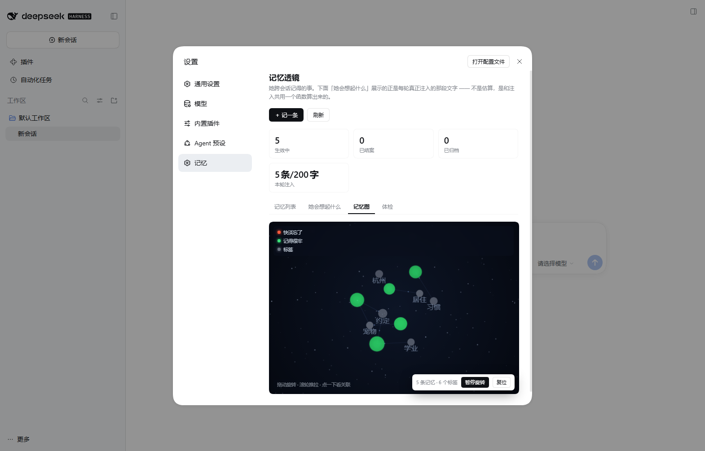

# dsh-memory-lens · 记忆透镜

[](https://github.com/Afeng-ovo/dsh-memory-lens/actions/workflows/ci.yml)
[](https://www.npmjs.com/package/dsh-memory-lens)
[](https://github.com/Afeng-ovo/dsh-memory-lens/blob/main/LICENSE)

给 [DeepSeek Harness](https://github.com/deepseek-ai) 的长期记忆插件。让 agent 跨会话记住你的事：稳定事实、偏好、答应过的约定、发生过的事件。重启之后她仍然记得。

自带存储、自带工具、自带设置页，**不依赖任何其他插件或服务**。

> 名字叫「透镜」是因为它的重点不在存，而在**看清楚存了什么**：哪些事她记得牢、哪些快淡忘了、哪些之间有牵连。记忆系统最怕的不是忘，是「你以为她记得，其实她早就不提了」。

---

## 它解决什么问题

LLM 的上下文是会话级的。你今天告诉它「我在准备考研，别在这期间给我排旅行」，明天开个新会话，这句话就不存在了。

常见的补法是「把历史对话全塞回去」或者「自动抽取每轮对话存成记忆」。前者会把上下文撑爆，后者会把「嗯」「好的」「我看看」这类废话也存进库 —— 噪音一多，检索质量断崖式下跌，用户最后干脆把这个功能关掉。

这个插件走第三条路：

- **记忆由 agent 自己判断要不要记**。三个工具 `remember` / `recall` / `forget`，代价是它得多想一步，好处是库里每一条都有人为它负责。
- **注入有硬预算**。每轮最多 1200 字、12 条，超了按重要度少注入几条，绝不截断单条正文。上下文是稀缺资源，无节制的注入等于慢性自杀。
- **注入和检索用同一个打分函数**。否则「面板上显示的」和「她真读到的」会变成两套真相，而这恰恰是记忆系统最不能出的问题。
- **会淡忘，但淡忘不是删除**。强度低于阈值自动归档，归档条目仍可被检索和复活。
  整理在**启动时**和**每次写入后**各跑一次（同一分钟内不重复），一次最多沉 3 条 ——
  衰减本来就慢，某天突然沉掉几十条，多半是半衰期被调错了，等发现时已经「失忆」。
  刻意不挂后台定时器：一个插件悄悄改你的记忆文件、你既看不见也没法阻止，这种事不该发生。

---

## 安装

**不用手动改 `package.json`。** `dsh plugin add` 装完会自动把包名写进 `dsh.profile.bundles`，重启就生效。

### 图形界面（最省事）

设置 → **插件** → **添加插件** → 填 `dsh-memory-lens` → 安装 → 重启 DSH。

也可以填 GitHub 地址（`https://github.com/Afeng-ovo/dsh-memory-lens`）、tarball 地址，或本机绝对路径。

### 命令行

```bash
# 装到默认 profile
dsh plugin add dsh-memory-lens

# 装到指定 profile
dsh plugin --profile desktop add dsh-memory-lens
```

三种来源都认：

```bash
dsh plugin add dsh-memory-lens                        # npm 包
dsh plugin add github:Afeng-ovo/dsh-memory-lens       # GitHub 仓库
dsh plugin add /绝对/路径/到/dsh-memory-lens           # 本地目录（开发用）
```

> **CLI 的前置条件**：`dsh plugin` 把参数转发给 `pnpm`，所以 `pnpm` 必须在 PATH 里。
> 桌面版内置了 pnpm（`resources/runtime/primary-runtime/dependencies/pnpm`），
> 但从终端直接跑 CLI 时它不一定在你的 PATH 中 —— 报 `'pnpm' 不是内部或外部命令` 就是这个原因。
> 遇到就装个 pnpm（`npm i -g pnpm`），或者改用上面的图形界面。

装完**重启 DSH**。设置页左侧会出现「记忆」分区。

### 卸载

```bash
dsh plugin remove dsh-memory-lens
```

记忆文件留在 `$DSH_HOME/memory-lens/memory.json`，不会被卸载带走 —— 重装回来还是那些记忆。
不想要了就手动删这个文件。

**配置**：装好就能用，全部有默认值。要改的话两种方式 ——

图形界面：设置 → **插件** → `dsh-memory-lens` 那一行的 **配置**，改完即时生效。

或写进 `~/.dsh/profiles/<profile>/cordis.patch.yml`：

```yaml
- id: memory-lens            # 必须等于插件的 settings 命名空间，别改
  name: dsh-memory-lens
  config:
    storeFile: ''            # 空 = $DSH_HOME/memory-lens/memory.json
    injectEnabled: true
    injectLimit: 12
    injectMaxChars: 1200
    decayHalfLifeDays: 365
    decayArchiveBelow: 0.08
    maxEntries: 1000
```

---

## 三个工具

| 工具 | 用途 | 关键点 |
| --- | --- | --- |
| `remember` | 记一件事 | 同一件事换个说法时传 `supersedes` 指向旧条目，旧条目标为「已取代」而不是删掉 |
| `recall` | 按关键词查 | 和注入共用打分函数，`touch=true` 会更新「想起次数」 |
| `forget` | 忘掉一条 | `mode=resolve` 结案（仍可被提起）· `mode=delete` 真删 |

**它不会自己偷偷记。** 如果你希望 agent 主动记住某事，在对话里说一句「这个记一下」就行。

---

## 设置页「记忆」

装好后：设置 → 左侧导航 **记忆**。一个页面五块：

- **KPI 四格**：生效中 / 已结案 / 已归档 / 本轮注入（注入超预算时这一格变红并显示超出多少字）
- **记忆列表**：按状态筛选、搜正文或标签，每条可续命 / 结案 / 归档 / 编辑 / 删除
- **她会想起什么**：直接显示后端算出的注入块原文 —— 不是「大概会想起这些」，是真的那一整段
- **记忆图**：三维星图。每条记忆是一个光点，共享标签的记忆之间连边。红色＝快淡忘了，绿色＝记得很牢，灰色＝标签节点。点一下看详情和关联，拖空白转视角，滚轮推拉远近，「暂停旋转」停住它，方便点中某个点。
- **体检**：把「正文太长会被截断」「约定却一次都没被想起」这类问题先挑出来

星图是 canvas 2D 手写透视投影，**零外部依赖** —— 不引 three.js 是刻意的：多一个依赖就多一个「打不开」的理由。



---

## 数据

默认存在 `$DSH_HOME/memory-lens/memory.json`。`$DSH_HOME` 跟着 DSH 自己的数据根目录走，换机器、换盘都不会丢。

```jsonc
{
  "version": 1,
  "buckets": {
    "shared": [
      {
        "id": "lm-mvjb07iln17s",
        "kind": "fact",              // fact | pref | promise | event
        "text": "阿风在准备考研",
        "tags": ["学业"],
        "weight": 4,                 // 1~5
        "status": "active",          // active | resolved | archived | superseded
        "dueAt": { "when": "2026-12-20", "ts": 1797000000000 },
        "createdAt": 1791000000000,
        "hits": 3,                   // 被想起过几次
        "lastUsedAt": 1792000000000
      }
    ]
  }
}
```

**纯 JSON，可读可改可同步。** 想放进坚果云/OneDrive 做多机同步，把 `storeFile` 指过去就行。文件被外部改动时插件会自动重新加载，不会拿着内存里的旧副本装作没事。

---

## 面板里能做的事

- 记一条 / 编辑 / 续命 / 结案 / 撤销结案 / 归档 / 复活 / 删除（删除有二次确认）
- 按状态筛选、按正文或标签搜索
- 想看原始数据就直接开 `$DSH_HOME/memory-lens/memory.json` —— 想备份、想同步、想手改，就那一个文件

**从别的记忆系统迁移**（没有按钮，走接口）：

```bash
# 接受 { items: [...] } 或完整的 { buckets: { shared: [...] } }
curl -X POST http://127.0.0.1:<端口>/dsh-memory-lens/api/import \
  -H 'content-type: application/json' \
  --data-binary @old-memory.json
```

按「正文 + 类型」去重，重复的跳过；返回 `{ ok, added, skipped, total }`。
老数据缺 `status` 字段会自动补 `active`，所以别的系统的库可以直接倒进来。

---

## 开发

```bash
node test/tools.test.mjs    # 工具层：26 项
node test/host.test.mjs     # 宿主半装配：10 组
node test/client.test.mjs   # 客户端半装配：4 组
```

三个测试都是**跑真实代码**（最小桩，不是复制一份逻辑），因为这类插件的失败模式大多是「装上了，但什么都没发生」—— 没有异常、没有日志，只是那个页面不出现。

### 结构

```
lib/
  index.js          宿主半：systemPrompt 注入 + 衰减整理 + 4 条 HTTP 路由 + Config
  tools.js          三个工具
  store.js          存储（原子写 + mtime 感知外部改动）
  core/long-memory.js   纯逻辑：打分 / 衰减 / 检索 / 去重（零 IO 依赖，可单测）
  client.js         客户端半：设置页分区（含三维星图）
cordis.patch.yml    loader entry
```

`core/` 刻意不碰 `ctx`、不碰 `fs`，只有纯函数。这样打分和衰减逻辑可以脱离 DSH 单独验证 —— 这两块一旦算错，整个插件的行为就全错了，而它们最容易在「看起来正常」的表象下悄悄算错。

---

## 已知边界

- **不做自动抽取**。这是设计选择，不是还没做。
- **单桶**（`shared`）。core 支持多桶，但一个 agent 一个记忆库就够了，多桶只会让「她到底记得什么」变模糊。
- **不加密**。文件是明文 JSON。密钥、证件号这类东西在写入前会被 `looksSensitive()` 拦掉，但拦的是模式匹配，不是保险箱。真有敏感信息需求，请用 `storeFile` 指向一个你自己加密的盘。
- **中文优化**。分词按字 + 二元组做，英文检索能用但不如中文准。

---

## License

MIT
